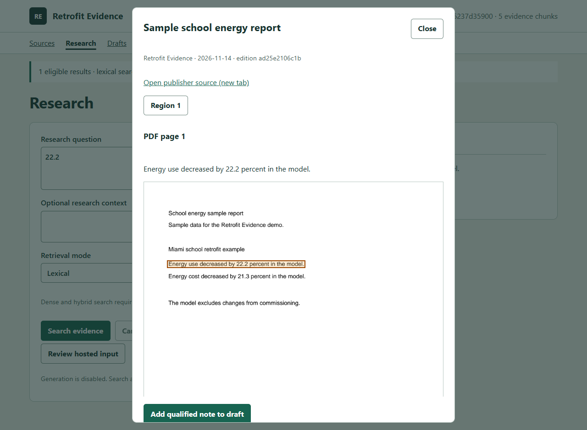

# Retrofit Evidence | School Energy Research Assistant

Retrofit Evidence helps facilities teams review reports on school energy upgrades. Search public PDFs, check the original page, and export a draft with citations.

*Screenshot from the working app with a sample PDF.*

**[Try the sample](docs/run-locally.md#try-the-sample)** · **[See an exported draft](examples/sample-draft.md)** · **[Read the design notes](docs/design.md)** · **[View test results](evidence/distribution-verification.md)**

## What the app does

- Add a public PDF. Record its publisher, source link, and terms of use.
- Review the extracted text against the original page. Select the parts that search can use.
- Search by word or phrase. Open the cited page to check a result and its notes.
- Add evidence to a draft. Export the draft as Markdown or JSON.

Search and drafting run locally without a paid model. Optional model files enable search by meaning and search that combines both methods.

## Run it

Use Docker with Linux containers. The app opens in your browser at `http://127.0.0.1:8765`.

1. Clone this repository.
2. Start Docker.
3. Run the command for your system from the repository folder.

| System | Command |
| --- | --- |
| Windows | `.\platform\Start-RetrofitEvidence.ps1` |
| macOS or Linux | `./deploy/start-local.sh` |

Windows Chrome and Linux on Intel, AMD, and ARM passed the local workflow tests. The Mac launchers still await testing on a Mac. [Setup, downloads, and stop commands](docs/run-locally.md)

## How it works

Python and FastAPI handle file intake, search, and export. TypeScript runs the browser interface. SQLite stores document records and supports full-text search. The PDF parser runs in a separate Linux process with limits on memory, run time, and network access.

## What the tests show

The test suite checks PDF intake, page review, search, and export. Browser tests cover keyboard use and zoom. The HTTPS setup passed a local test. [Results and test scope](evidence/distribution-verification.md)

The app starts with hosted answer generation disabled. The starter collection and generated-answer quality still await formal review. Exports are drafts for review.
